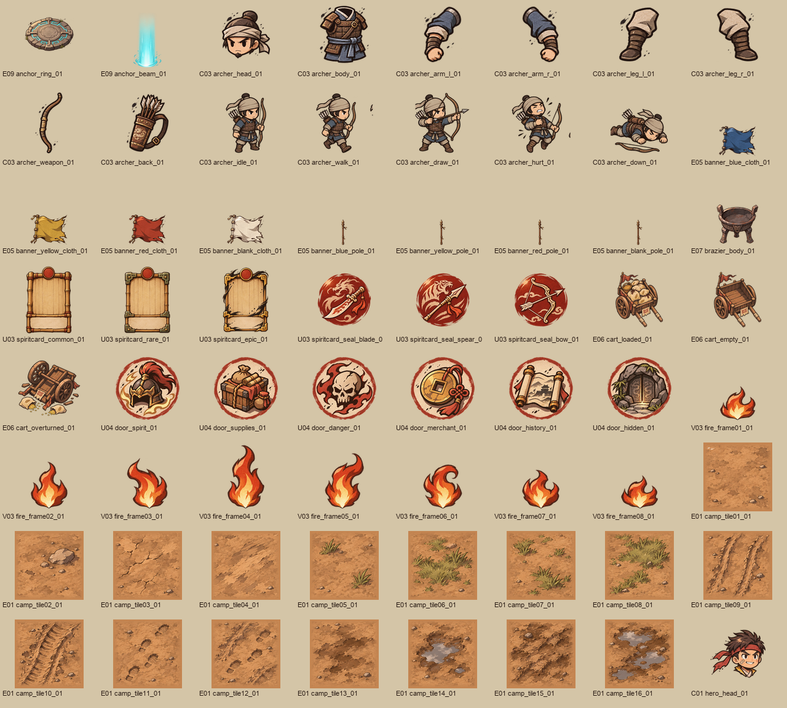
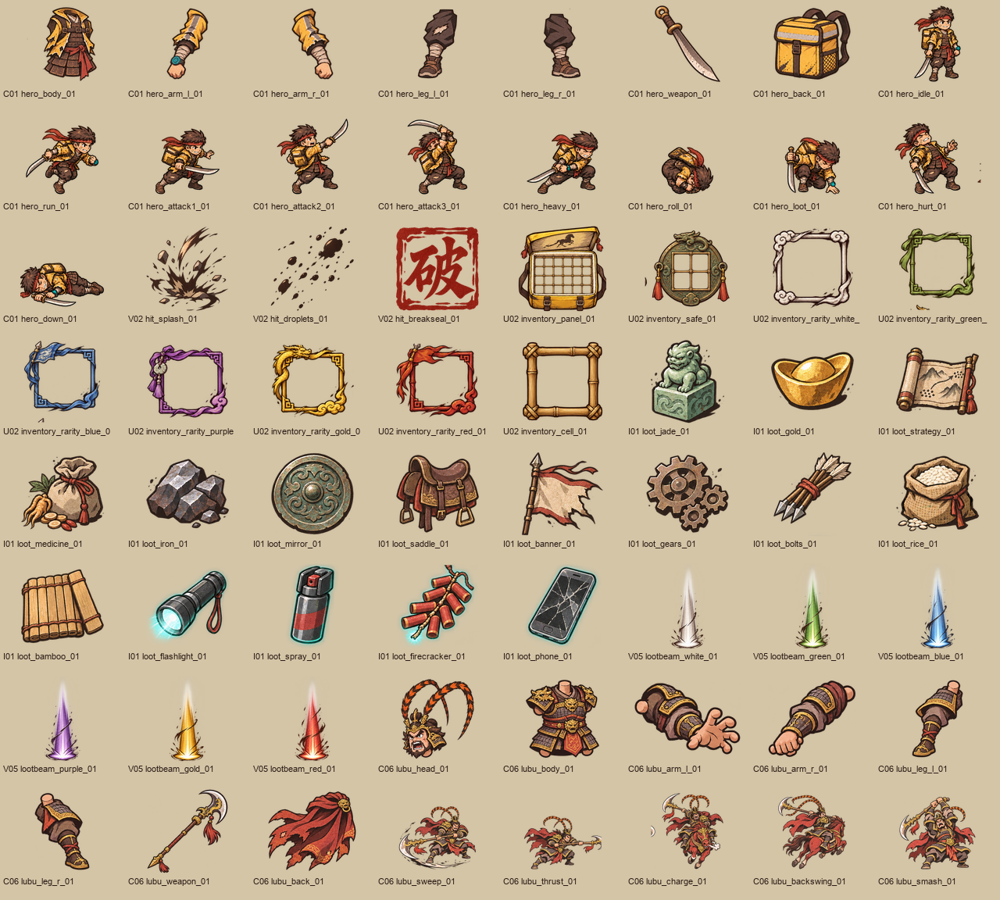
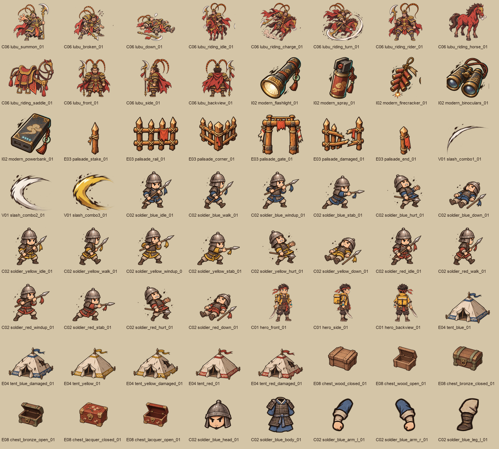
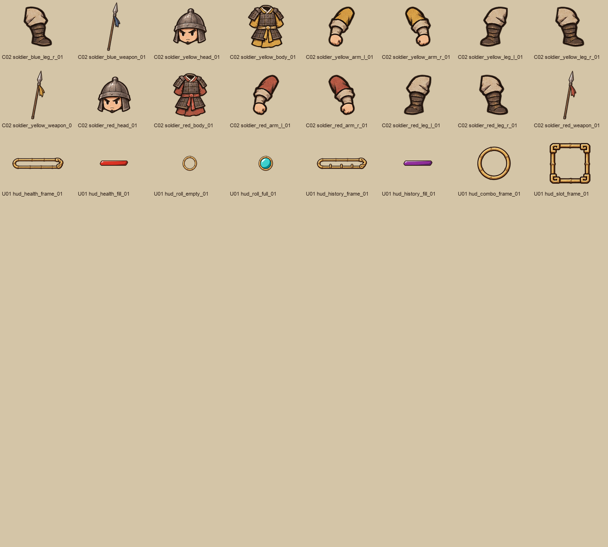

# T002 · Demo 美术 P0 交付

状态：待主策验收。主美：Codex。分支：`art/T002-demo-p0`。基线：`main 57ea345`。

[打开验收页](preview.html) · [尺寸与锁点清单](assets.json) · [技术检查](qa/validation.json) · [任务需求](../../../docs/03-Demo美术需求清单.md)

共 **216 张独立 PNG、25 张生成原图**，覆盖 22 项 P0。生成方式为内置 imagegen，提示词均拼接 STYLE；逐图原始/修订提示词位于 [prompts/](prompts/)，原图位于 [sources/](sources/)。已有主角、联军兵、营帐和宝箱沿用主策切图使用的 batch1 01 号设计。

| 编号 | 交付 | 独立 PNG |
| --- | --- | ---: |
| C01 | 主角三视图、8 拆件、10 个动作关键姿势 | 21 |
| C02 | 蓝/黄/红各 7 拆件、各 6 个动作关键姿势；三视图见 batch1 原图 | 39 |
| C03 | 弓手 8 拆件、5 个动作关键姿势 | 13 |
| C06 | 吕布三视图、8 拆件、8 个战斗关键姿势、3 个骑战参考与骑手/马/鞍拆分 | 25 |
| E01 | 256×256 营地地砖，干土/草地/车辙脚印/泥坑各 4 块 | 16 |
| E03 | 木栅栏：单桩、横栏、转角、开口、破损、收尾 | 6 |
| E04 | 蓝/黄/红营帐，各完好与破损，320×300 | 6 |
| E05 | 蓝/黄/红/空白旗布与独立长旗杆 | 8 |
| E06 | 满载/空载/翻倒辎重车，280×180 | 3 |
| E07 | 无火火盆，80×120 | 1 |
| E08 | 木/铜/漆箱，各关闭/打开，88×72 | 6 |
| E09 | 锚点地环 320×128、独立光柱 | 2 |
| U01 | 血条框/填充、翻滚空/满、修正力框/填充、连击框、道具框 | 8 |
| U02 | 6×4 背包、2×2 护心镜、六色品质框、单格竹框 | 9 |
| U03 | 普通/稀有/史诗将魂卡框、刀/枪/弓图形印章 | 6 |
| U04 | 将魂/物资/危险/商人/历史/暗室门图标 | 6 |
| I01 | 16 个物品图标，256×256（显示 128×128） | 16 |
| I02 | 手电/喷雾/鞭炮/望远镜/充电宝，256×256 | 5 |
| V01 | 三段刀光，第三段金色 | 3 |
| V02 | 墨溅、墨滴、需求指定的“破”字印章 | 3 |
| V03 | 火焰 8 帧，统一 128×128 画布、缩放与底部原点 | 8 |
| V05 | 白/绿/蓝/紫/金/红六色出货光柱 | 6 |

## 验收自检

- [x] 22 项 P0 资源已覆盖，命名使用 `类别_名称_部件_序号.png`，分入 art/char、env、prop、ui、icon、vfx。
- [x] 216 个独立资源全部可解码，200 张为真实透明 RGBA，16 张地砖为不透明 RGB；独立资源嵌入 sRGB 配置。
- [x] 清单记录画布尺寸、显示倍率 0.5、内容包围盒、脚底/地面原点、拆件关节提示、来源矩形及 SHA-256。
- [x] 所有源图和独立资源均小于 20 MB。
- [x] 地砖以 24px 干土过渡统一边界，全部 256 种两两组合的横/纵边缘像素一致；验收页含混排预览。
- [x] 已检查 25 张原图与 4 张最终素材联系表；已修正主角动作图地台、栅栏文字、光柱裁切、HUD 白底与装饰干扰。
- [x] 仅修改 art/，未修改 art/prompts/、docs/、prototype/、game/ 或 tools/。

## 差异与需主策重点验收

1. 角色交付为拆件及关键姿势，不是逐帧动画，符合美术清单的骨骼动画方案。关节提供隐藏端与 10px 重叠目标；**尚未在 Godot 中拼装验证关节遮挡与左右镜像**。各关键姿势使用统一画布与缩放，个别夸张动作仍可能需要主程按身体接地点调原点。
2. 尺寸为交付画布尺寸，保留透明边距。特殊姿势的武器、羽冠和骑战会占更宽画布；请依据 assets.json 的内容包围盒与原点放置，不要按文件外框估计脚底。
3. U03 使用刀、虎枪、弓图形印章区分战斗意象；汉字标题、将魂说明、派系名称由程序叠加。需要主策确认图形印章方案。
4. V02 保留 D26 明确指定的“破”字；其余独立资产不含可读文字、商标或水印。
5. V03 提供 8 帧及建议 8fps 循环参数，未在正式场景播放验收。火焰形变节奏与 V05 光柱亮度需主策目测。
6. 不包含 P1/P2（例如西凉骑兵、貂蝉、时空守卫、关墙、庄园、I03 将魂能力图标）。吕布骑战中的马仅服务 C06 交付。
7. 按角色边界没有修改切图脚本或游戏接入。主程可直接从 art/ 选用独立 PNG；后续重跑旧 tools/extract_sprites.py 仍只会切 batch1 原图，正式资源接入由主程处理。
8. 验收页已做脚本语法和本地引用检查；内置浏览器的 file:// 打开被安全策略阻止，未声称完成浏览器交互验收。可在本机直接打开 preview.html 查看。

## 预览

等待主策按需求逐项评论“验收通过”或退回原因。任务板由主策维护。
